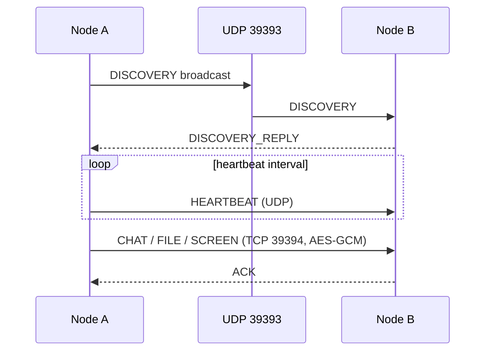

# LanSphere 🌐
### *Redefining Local Network Collaboration*


---

## 📖 Project Overview

**LanSphere** is a high-performance LAN collaboration suite that empowers computers connected to the same Local Area Network (subnet) to communicate, share files, organize into channels, and stream data securely **without relying on external internet connections or third-party cloud servers**.

While ordinary chat apps depend on remote SaaS backends, LanSphere operates directly at the physical network edge, leveraging full wire speeds (Gigabit LAN up to 1000 Mbps) with sub-2ms round-trip latency. It serves as both an enterprise-grade collaboration tool (analogous to Microsoft Teams, Slack, and Discord) and a rigorous demonstration of Computer Networks principles.

---

## ✨ Key Features & Modules

LanSphere is composed of 12 integrated modules:

1. **Authentication & Session Management**
   - Username and password authentication with BCrypt hashing.
   - Stateless JWT tokens with automatic header injection.
   - Pre-seeded test peers for immediate evaluation (`alice`, `bob`, `charlie`, `david`).

2. **Command Dashboard**
   - Real-time LAN telemetry (latency, packet loss, bandwidth consumption).
   - Live peer count, messages dispatched, storage volume, and active transfers.
   - Interactive quick-action shortcuts for messaging, file distribution, and group creation.

3. **Direct & Channel Chat**
   - Direct 1-on-1 peer conversations and multi-user group channels.
   - File attachment integration inside chat threads with inline download triggers.
   - Typing indicator simulation, delivery/read receipts, and emoji shortcuts.

4. **LAN File Sharing**
   - Drag-and-drop file upload zone with live upload progress tracking.
   - Multi-category filtering: Images, Videos, Documents, Archives.
   - Real-time SHA-256 cryptographic checksum calculation for end-to-end data integrity.

5. **Groups & Channels**
   - Create public or private LAN topic groups.
   - Member management, membership limits, and real-time announcement broadcasting.

6. **Peer Network Roster (Users)**
   - Live subnet node discovery with hardware MAC and local IPv4 display.
   - Status indicators (`ONLINE`, `AWAY`, `BUSY`, `OFFLINE`) and last-seen timestamps.

7. **Network Monitor & Diagnostics**
   - Telemetry gauges for ping round-trip time, packet jitter, and LAN adapter saturation.
   - OSI stack layer status diagnostics (Layers 2, 3, 4, 7).
   - Subnet node probe catalog displaying connected peer IP/MAC identifiers.

8. **Downloads Manager**
   - Configurable local download destination folder.
   - Transfer history with SHA-256 integrity validation and one-click disk saving.

9. **Notification Center**
   - Slide-over notification drawer with unread counter badges.
   - Categorized alerts for direct messages, file transfers, and group invitations.

10. **Node Security & Activity Logs**
    - Audit logging for network events, logins, and transfer activities.
    - Searchable by action code, client IP address, and timestamp.

11. **Settings & Node Profile**
    - Identity customization (display name, bio, avatar URL, presence).
    - Subnet broadcast toggles and dark/light UI mode switcher.

12. **About & Architecture Hub**
    - System specifications, Computer Networks concept breakdown, and protocol roadmap.

---

## 🏗️ Architecture & Clean Code Principles

```
LanSphere
├── Application Layer (L7)     ─── REST APIs + WebSocket (STOMP Protocol)
├── Transport Layer (L4)       ─── TCP Sockets (Port 8080)
├── Network Layer (L3)         ─── IPv4 Subnet Routing (e.g. 192.168.1.0/24)
└── Data Link / Physical (L2)  ─── Gigabit Ethernet / 802.11 Wi-Fi Backbones
```

### Backend Layering (Spring Boot 3 + Java 21)
- **Controller Layer**: REST controllers exposing clean JSON endpoints wrapped in `ApiResponse<T>`.
- **Service Layer**: Transactional business logic orchestrating entities, repository queries, and STOMP message broadcasting.
- **Repository Layer**: Spring Data JPA repositories with custom derived and JPQL queries.
- **Entity Layer**: Relational entities with automatic timestamps and proper relationships (`@ManyToOne`, `@OneToMany`).
- **Security**: Stateless JWT filter, CORS configurator, BCrypt password encoder.
- **Database**: SQLite embedded engine for zero-configuration local persistence.

### Frontend Layering (React + TypeScript + Vite)
- **Design Tokens**: TailwindCSS with HSL color palettes and dark mode support.
- **State Management**: Zustand stores (`useAuthStore`, `useThemeStore`, `useNotificationStore`).
- **Data Fetching**: Axios client with request/response interceptors for JWT injection.
- **Routing**: React Router DOM v6 with protected layout wrappers.

---

## 📁 Project Structure

```
CNL_MiniProject/
├── lansphere-server/                  # Java 21 Spring Boot Backend
│   ├── pom.xml                        # Maven configuration
│   └── src/main/
│       ├── java/com/lansphere/
│       │   ├── LanSphereApplication.java
│       │   ├── config/                # WebSocketConfig, WebMvcConfig, DataInitializer
│       │   ├── controller/            # REST Controllers (Auth, Chat, File, Network, etc.)
│       │   ├── dto/                   # Request & Response DTO models
│       │   ├── entity/                # JPA Entities & Enums
│       │   ├── exception/             # GlobalExceptionHandler, Custom exceptions
│       │   ├── network/               # ALPP packet protocol & future interface contracts
│       │   ├── repository/            # Spring Data JPA Repositories
│       │   ├── security/              # JWT Provider, Auth Filter, SecurityConfig
│       │   ├── service/               # Core business services
│       │   └── util/                  # DtoMapper, NetworkUtil
│       └── resources/
│           └── application.properties # SQLite, JWT, and multipart configs
│
├── lansphere-client/                  # React TypeScript Frontend
│   ├── package.json                   # Dependencies & scripts
│   ├── vite.config.ts                 # Vite bundler & reverse proxy setup
│   ├── tailwind.config.js             # Tailwind design tokens
│   ├── src/
│   │   ├── main.tsx                   # React root entry
│   │   ├── App.tsx                    # Routes & Layout definition
│   │   ├── index.css                  # HSL tokens, glassmorphism, scrollbars
│   │   ├── types/                     # TypeScript model definitions
│   │   ├── services/                  # Axios API services
│   │   ├── stores/                    # Zustand state management stores
│   │   ├── components/layout/         # AppLayout, Sidebar, Navbar, NotificationDrawer
│   │   └── pages/                     # 12 Page module components
│   └── index.html
└── README.md
```

---

## 🚀 Installation & Running Instructions

### Prerequisites
- **Java Development Kit (JDK) 21+**
- **Apache Maven 3.8+**
- **Node.js 18+ & npm**

### 1. Running the Backend Server
```bash
cd lansphere-server
mvn spring-boot:run
```
*The backend starts on port **8080** (Context path: `/api`). On the very first startup, `DataInitializer` seeds test accounts (`alice`, `bob`, `charlie`, `david`) with sample conversations and groups.*

### 2. Running the Frontend Client
```bash
cd lansphere-client
npm install
npm run dev
```
*The frontend client runs on `http://localhost:5173`. Open in your browser to start collaborating.*

### Quick Test Credentials
| Username | Password | Role |
| :--- | :--- | :--- |
| `alice` | `password123` | Systems Lead |
| `bob` | `password123` | Infrastructure |
| `charlie` | `password123` | Socket Engineer |
| `david` | `password123` | Protocol Analyst |

*(Alternatively, use the **1-Click Test Peer** buttons on the Sign In page for instant access).*

---

## Local Networking Engine

LanSphere now runs a local networking engine alongside Spring Boot. The browser continues to use the existing REST API; the local server performs LAN discovery and exchanges peer data over LSAP packets.



The engine uses UDP broadcast discovery, peer heartbeats, a TCP server worker pool, LSAP framing with SHA-256 checksums, AES-GCM payload encryption, chunked file delivery, screen frame streaming, retransmission retries, packet deduplication, and live metric counters. Networking settings are in `lansphere-server/src/main/resources/application.properties`. Nodes must use the same `app.network.shared-secret`.

## 🔮 Future Networking Roadmap

The current implementation is designed for a trusted LAN with a shared application secret. The next practical improvements are authenticated per-peer key exchange, persistent peer identity storage, a browser screen-view adapter, selective acknowledgements for parallel file chunks, and operating-system level interface telemetry.

---

## 👥 Contributors & Academic Context

Developed as a flagship **Computer Networks Laboratory (CNL) Project** demonstrating full-stack engineering, socket architectures, and local network collaboration.
